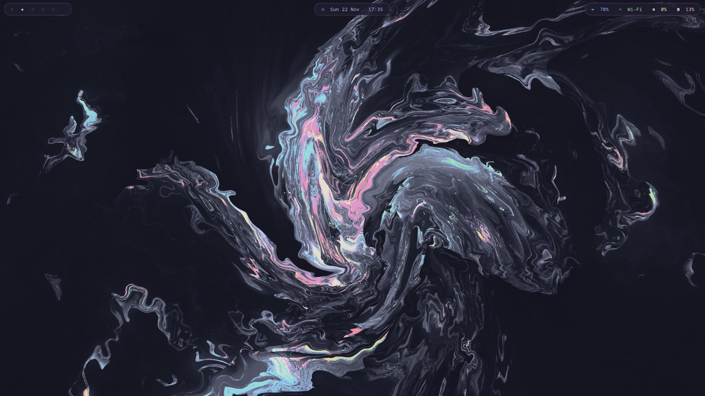
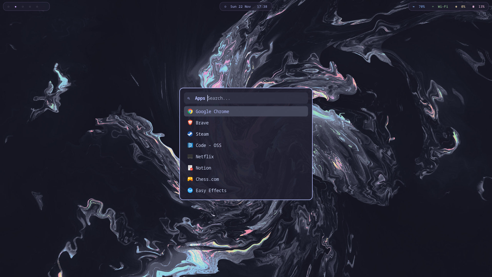
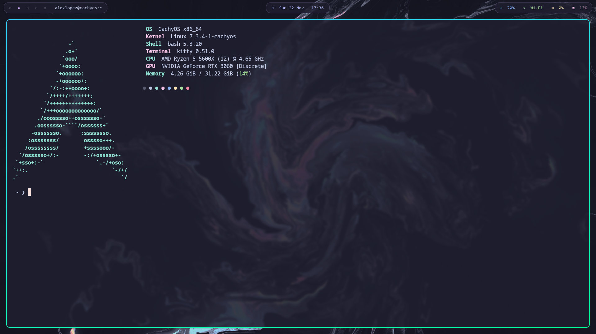
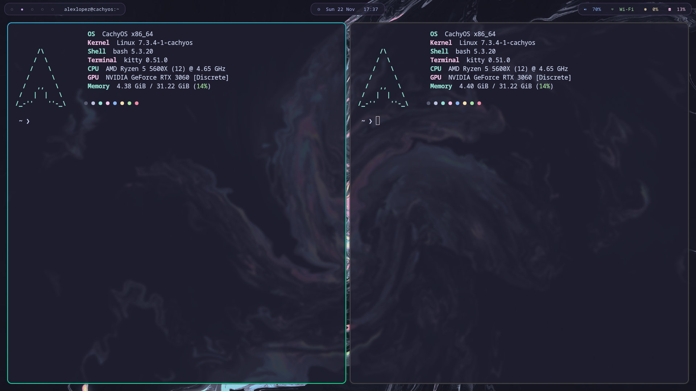

# cachyos-hyprland-dotfiles

My CachyOS desktop: Hyprland (Lua config) with a floating three-island waybar,
rofi and kitty, all in **Catppuccin Mocha**. Managed with GNU Stow.

## What's inside

- `hypr`: Hyprland config (needs 0.57+, which uses `hyprland.lua`)
- `waybar`: top bar with workspaces, clock, volume, network, CPU and RAM
- `rofi`: app launcher
- `kitty`: terminal (JetBrainsMono Nerd Font, transparency and blur)
- `starship`: one-line prompt
- `fastfetch`: Arch logo that shrinks with the window width
- `bash`: `.bashrc` with ble.sh
- `wallpapers`: default wallpaper

## Requirements

Install the packages first (Hyprland 0.55+ is required):

    sudo pacman -S hyprland waybar rofi awww kitty starship fastfetch stow \
      papirus-icon-theme ttf-jetbrains-mono-nerd

ble.sh is not in the official repos, so install it from the AUR.

## Install

Clone it into `~/dotfiles` (Stow needs it there) and link what you want:

    git clone https://github.com/AlejandroLopezData/cachyos-hyprland-dotfiles ~/dotfiles
    cd ~/dotfiles
    stow hypr waybar rofi kitty starship fastfetch bash wallpapers

Stow won't overwrite existing files. If it reports a conflict, move
the old file away and run it again.

## Notes

- The wallpaper is set on startup in `hyprland.lua` with awww.
  To use another one, change the path there.
- `.bashrc` loads `~/.bashrc.local` if it exists. Put personal stuff there;
  it is not tracked.
- `hypr/.config/hypr/setup-launcher.sh` hides most apps from the launcher
  and adds Netflix and Chess.com entries. Read it and edit the list before
  running it.
